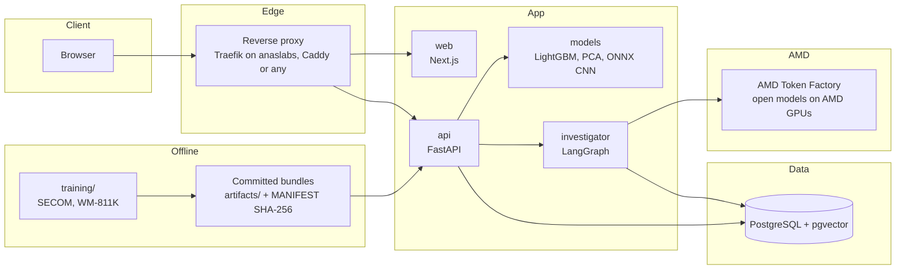
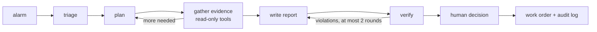

# Yield Guardian: Implementation Plan

| | |
|---|---|
| Version | 1.0 |
| Date | 2026-10-14 |
| Event | AMD Developer Hackathon: ACT III, track **Intelligent Industry** |
| Live status | [STATUS.md](STATUS.md) |
| Owner | anas-aldahamsheh |

This document is the single source of truth for what we build and how. Every work item here has an ID that appears in [STATUS.md](STATUS.md), where its state is tracked.

---

## 1. The product

Yield Guardian is an investigation console for the yield and quality engineers of a semiconductor fab. It replays real production data in its original time order, as if it were coming off the line now, and:

1. flags wafers that are likely to fail final test while there is still time to act,
2. narrows 590 sensor readings down to the few sensor groups statistically associated with the failure,
3. detects process drift with the multivariate control charts fabs already use,
4. reports sensor health problems (dead, frozen or jumping sensors),
5. classifies wafer-map defect patterns and says "unknown pattern" when it has not seen one before,
6. finds lots where a pattern repeats more often than chance allows,
7. runs an AI investigator that gathers this evidence with read-only tools and writes a report that an engineer approves or rejects, which opens a work order.

**Who uses it:** yield engineers, process engineers, quality managers.
**What it improves:** quality (failures caught before final test), time (fewer sensors to inspect per investigation), efficiency (share of wafer maps classified automatically at a measured precision).

## 2. Ground rules

These rules decide every trade-off in this plan.

1. **Real data only.** No synthetic samples (no SMOTE, no GAN maps), no invented sensor names, no invented costs or savings.
2. **Every metric is measured on data the model never saw**, and carries a 95% confidence interval.
3. **Association is not causation.** The product says "statistically associated with failure", never "caused".
4. **Language models never produce numbers.** Every number in generated text is checked by code against tool outputs.
5. **Humans approve actions.** The investigator recommends; an engineer decides.
6. **Reproducible to the byte where possible:** pinned dependencies, fixed seeds, SHA-256 of every dataset and artifact, git commit recorded in every experiment.
7. **Limitations are published next to results**, not hidden in an appendix.

## 3. Fit with the hackathon

| Requirement (from the Act III page) | Where it is met |
|---|---|
| A real manufacturing problem | Late failure detection, root-cause search, drift, defect patterns (§6) |
| Realistic industrial data | SECOM (real fab sensor data, UCI) and WM-811K (real fab wafer maps) (§5) |
| Alert, explanation, recommendation or action | Alarms, SHAP and contribution evidence, investigator report, approve/reject work orders (§7, §8) |
| A working product, not only a dashboard | Stateful workflow: alarm, investigation, decision, work order, audit log |
| Results operators understand | Plain-language report with every claim linked to its evidence |
| Measurable improvement | Held-out metrics with confidence intervals (§6.9) |
| AMD is part of the working product | All language-model roles run on AMD GPUs through AMD Token Factory; training code is ROCm-ready (§7) |
| Public repo, MIT, demo video, slides, cover image, app URL | §14 and X1–X6 in STATUS |

Judging criteria and our answer:

- **Application of technology:** one model per role, chosen by a measured evaluation; deterministic-first routing; cached AMD inference with recorded runs.
- **Presentation:** the "Yellow Room" interface (§9) and a demo that runs on real data.
- **Business value:** measured early-detection and time savings, with a cost calculator that uses the fab's own numbers.
- **Originality:** physically computed wafer rendering, statistical lot excursion tests, an investigator whose every sentence is verifiable.

## 4. Architecture



- **web:** Next.js App Router. Renders pages, streams investigator events (SSE) and the live line (WebSocket).
- **api:** FastAPI. Owns the data, the models, the investigator and every rule in this plan.
- **db:** PostgreSQL with pgvector. Also hosts the job queue (`SELECT ... FOR UPDATE SKIP LOCKED`), so no extra service has to wake up.
- **training/:** offline pipelines. They write versioned artifacts and model cards; the API only reads them.

### Repository layout

```
yield-guardian/
├─ apps/web/                Next.js + TypeScript + Tailwind + shadcn/ui
├─ services/api/            FastAPI app, science services, investigator
├─ packages/contracts/      OpenAPI schema and generated TypeScript types
├─ training/
│  ├─ common/               splits, bootstrap, metrics, manifests
│  ├─ secom/                failure prediction, root cause, FDC, sensor health
│  └─ wafermap/             CNN, OOD, similarity, lot statistics
├─ data/                    manifests and download scripts (raw data is not committed)
├─ deploy/
│  ├─ compose/              standalone stack for any host
│  └─ anaslabs/             services for the anaslabs-hosting stack
├─ docs/                    PLAN, STATUS, METHODS, model cards, DATA
└─ .github/workflows/       CI
```

## 5. Data

| Dataset | What it is | Source | Licence | Committed? |
|---|---|---|---|---|
| SECOM | 1,567 production units, 590 anonymous sensor features, pass/fail result and timestamp (as documented by UCI; verified at load) | UCI Machine Learning Repository, dataset 179 | Verify on the UCI page at download; expected CC BY 4.0 | Only if the licence allows redistribution |
| WM-811K | 811,457 wafer maps from 46,293 lots, 172,950 labelled with one of 9 classes (Wu et al., 2015; counts verified at load, D2) | Kaggle mirror `qingyi/wm811k-wafer-map` (the MIR Lab page returned HTTP 404 on 2026-10-14) | Research dataset. The mirror lists CC0-1.0, set by the uploader, not the authors | No. Only a small derived demo subset, with attribution |

- Downloads run on the owner's PC (this cloud environment cannot reach UCI or MIR Lab).
- Every file gets a SHA-256 entry in `data/manifest.json` with source URL, download time and licence text.
- Facts written in this plan are rechecked during EDA (D3). If a number differs, the data wins and this plan is corrected.

## 6. Science

### 6.1 Early failure detection (SECOM)

- **Split:** chronological. Train, validation and test are consecutive time blocks (starting point 60/20/20 by time, adjusted after EDA so each block holds enough failures to measure). Hyperparameters are tuned with rolling-origin cross-validation inside the training block only. The test block is used once.
- **Preprocessing (fit on training folds only):** drop features constant in training; keep missing values as missing (LightGBM handles them natively); add a missingness indicator only where missingness is associated with the label in training data; no global imputation.
- **Baselines:** prevalence (no-skill), L2 logistic regression with median imputation and standardisation, random forest.
- **Main model:** LightGBM with class weights, tuned with Optuna (TPE) on average precision.
- **Calibration:** Platt scaling on validation predictions. Isotonic regression is rejected because there are too few failures to fit it without overfitting. Reported with a reliability diagram, Brier score and ECE.
- **Metrics:** PR-AUC (primary, shown against the prevalence line), ROC-AUC, recall and precision at false-alarm rates of 5% and 10%. 95% CIs from 2,000 stratified bootstrap resamples. Models are compared with a paired bootstrap.
- **Threshold:** set from the engineer's own cost ratio (missed failure versus false alarm). Until one is entered, the operating point is "5% false-alarm rate", and the UI says so.

### 6.2 Root-cause narrowing

- **Per-unit explanation:** TreeSHAP (exact for tree models).
- **Correlated sensors:** hierarchical clustering on Spearman |ρ| (distance 1 − |ρ|, average linkage, groups at |ρ| ≥ 0.8). Importance is reported per group, because SHAP splits credit arbitrarily between near-duplicate sensors.
- **Stability selection:** 100 bootstrap refits on training data; a group is "stable" when it lands in the top-k in at least 70% of refits.
- **Chance check:** label-permutation null distribution for group importance; p-values corrected with Benjamini–Hochberg at q = 0.05.
- **Univariate screen for transparency:** Mann–Whitney U per feature with BH correction.
- **Output:** a ranked list of stable, significant sensor groups, worded as association.

### 6.3 Drift detection (fault detection and classification)

- **Reference period:** the earliest block of passing units, checked for stationarity.
- **Model:** PCA on robust-scaled reference data, components kept to 90% explained variance (cross-checked with parallel analysis).
- **Statistics:** Hotelling T² with an F-distribution control limit, and SPE (Q) with the Jackson–Mudholkar limit, at α = 0.01 and 0.001.
- **Explanation:** per-sensor contributions to T² and SPE for every alarm.
- **Small, slow shifts:** EWMA and CUSUM on the leading sensor groups, with in-control run length calibrated on the reference period.
- **Validation:** false-alarm rate on held-out reference data; lead-time analysis between alarms and later failure rates. SECOM has no drift labels, and the methods page says so.

### 6.4 Sensor health

- Deterministic rules per sensor and time window: missing rate, flatline (zero variance), stuck values, sudden jumps (robust z-score of the first difference), readings outside the reference range.
- Missingness-versus-failure association per sensor: Fisher's exact test with BH correction.

### 6.5 Wafer-map pattern classification (WM-811K)

- **Classes:** Center, Donut, Edge-Loc, Edge-Ring, Loc, Near-full, Random, Scratch, none.
- **Splits:** (a) the official train/test split shipped with the data, for comparison with published work; (b) a lot-grouped split where no lot appears in two splits, because wafers of one lot are correlated. The official split is checked for lot overlap and both results are reported.
- **Input:** maps resized to a fixed grid with nearest-neighbour resampling, so no value is invented between "no die", "pass" and "fail"; one-hot channels.
- **Model:** compact residual CNN in PyTorch; focal loss with class-balanced weights.
- **Augmentation:** rotations by 90° and flips only (the dihedral group of the square), which keep a pattern's meaning.
- **Training:** AdamW, cosine schedule, mixed precision, early stopping on validation macro-F1, three seeds reported as mean ± standard deviation. Device-agnostic code: the same script runs on CUDA (local RTX 3060) and ROCm (AMD GPUs).
- **Evaluation:** macro-F1 (primary), per-class precision, recall and F1, confusion matrix, bootstrap CIs, temperature scaling for calibration, comparison with published results on the official split.
- **Export:** ONNX, with a parity test against PyTorch outputs.

### 6.6 Unknown patterns and similar wafers

- **Embeddings:** L2-normalised penultimate-layer features, stored in pgvector (HNSW, cosine).
- **Unknown-pattern score:** Mahalanobis distance on L2-normalised embeddings (shared Ledoit-Wolf covariance), with the energy score as a cross-check; threshold set at 95% in-distribution recall on validation. Energy was planned first but scored 0.545 leave-one-class-out AUROC against 0.922 for Mahalanobis (W6), so the method was switched; the choice used those results, which is disclosed.
- **Honest test:** leave-one-class-out. For each defect class, a model trained without it must flag it as unknown; we report AUROC per held-out class.
- **Similarity:** precision@10 on labelled test maps.

### 6.7 Lot excursions

- Per lot, the count of each pattern is tested against the training-period rate with a one-sided binomial test, BH-corrected across lots.
- A stacked die-level failure map per lot shows defects that repeat in the same place.
- Per wafer, a join-count statistic with a permutation p-value separates random failures from spatially clustered ones.

### 6.8 Pattern-to-cause knowledge

- A curated table from open-access literature: each row has the full citation and the page it comes from, and is shown as a hypothesis to check, not a fact.
- Documents are converted once with MinerU2.5-Pro, chunked, and searched with PostgreSQL full-text search. Token Factory serves no embedding model, and full-text search is deterministic.

### 6.9 What we will claim

Filled in from experiments only (see "Measured results" in STATUS):

- failures caught before final test at a fixed false-alarm rate, with CI;
- false alarms per 100 units at that operating point;
- sensors to inspect per investigation: 590 versus the median number in stable groups;
- share of wafer maps classified automatically at a measured precision, with CI.

Money appears only through a calculator where the engineer enters their own costs.

## 7. AI layer

### 7.1 Roles

| Role | Default model | Why | Reasoning effort |
|---|---|---|---|
| Investigator (plans, calls tools) | DeepSeek-V4.1-Flash | Tool calling, 1M context, lowest price | low |
| Report writer | DeepSeek-V4.1-Flash, then MiMo-V2.6-Flash as fallback | Speed measured live on 2026-10-14: MiMo writes about 5 tokens/s, so a report of about 2,000 tokens outlasted the 180 s writer deadline, while DeepSeek answered the plan calls in 9 to 24 s. JSON output validated in code (the endpoint refused strict `json_schema` for MiMo) | low (MiMo: none) |
| Verifier | GLM-5.3-Flash | Different family from the writer | low |
| Engineer chat | Qwen3.8-Flash-Next | Fast | none |
| Router fallback | MiniCPM5-2B | Small; used only when deterministic rules cannot route | n/a |
| Document OCR | MinerU2.5-Pro | PDF to Markdown, run once at ingestion | n/a |
| Visual second opinion | DeepSeek-V4.1-Flash | Accepts images; never replaces the CNN | low |

- Defaults are starting points. The evaluation harness (L10) measures each candidate per role, and the admin can switch any role from the Models page without a restart.
- The live catalog is read from `GET /v1/models` at startup, because it changes. Each model has a capability profile taken from the Token Factory docs: system-message rules (Qwen: one system message, first), accepted `reasoning_effort` values (GLM rejects `xhigh`, Qwen3.8-27B rejects `high`), image input, `json_schema` support. Requests are built from the profile, so invalid combinations are never sent.
- The client is provider-agnostic (OpenAI-compatible). A real fab points it at its own vLLM endpoint on AMD Instinct hardware and no data leaves the site.

### 7.2 Calls and quota

Token Factory facts (dashboard and docs): daily cap of 1 point shared by the team, 20 requests per minute per account, 8 concurrent requests per key, reset at 19:00 Asia/Shanghai.

- **No request limits in the product (D-009).** The product never throttles, queues, delays or refuses a model call to protect the quota: no token bucket, no in-flight cap, no budget guard, no per-visitor or per-IP limits.
- **Quota is protected by how we build and test,** not by limiters: zero live calls in tests, as few manual checks as possible, each one small (`max_tokens: 64` for the smoke script).
- **Retries:** only when the AMD server answers 429, 502 or 503, with exponential backoff and full jitter, honouring `Retry-After`, at most 3 retries. This is error handling, not a limit.
- **Usage display:** `X-RateLimit-*` headers and `/v1/usage` are read only to show tokens, points and the remaining quota on the Models page.
- **Cache:** responses keyed by SHA-256 of model, messages, tools and parameters.
- **Recorded runs:** demo investigations are generated once and shown as "Recorded run" with model and time, so the demo is instant. A live run is always available.
- **Tests:** zero live calls. Recorded fixtures stand in for the API in CI.
- **Thinking costs tokens:** every role sets `reasoning_effort` explicitly.
- **Estimate to verify:** about 0.01 point per full investigation.

### 7.3 Investigator graph (LangGraph)



- **Tools (typed, read-only):** `get_unit`, `get_risk`, `get_shap`, `get_feature_groups`, `get_fdc_window`, `get_contributions`, `get_sensor_health`, `get_wafer_prediction`, `get_similar_wafers`, `get_lot_stats`, `search_knowledge`.
- Each tool result is stored as an evidence record with an ID. The report may only cite evidence IDs.
- State is checkpointed in PostgreSQL; progress streams to the UI over SSE.
- At most 8 tool steps per investigation.

### 7.4 Report contract and verification

```
Report
  summary: string
  findings[]: { claim, evidence_ids[], strength: "strong" | "moderate" | "weak" }
  actions[]: { action, rationale, evidence_ids[] }
  numbers[]: { value, unit, evidence_id, path }
  limitations[]: string
```

Verification, in order:

1. Schema validation: `json_object` output validated against the report schema in code (Pydantic) for every model; no model on the live endpoint accepted strict `json_schema` (measured 2026-10-14).
2. Every number in the text must appear in `numbers[]` and match the cited evidence at its path.
3. Every finding cites at least one existing evidence ID.
4. Causal wording ("caused", "root cause is") is rejected unless the evidence is a confirmed work-order outcome.
5. The verifier model checks that each claim is supported by its cited evidence.

Any violation sends the report back to the writer with the list of problems (at most 2 rounds); after that the report is shown with the remaining violations flagged.

### 7.5 Router

Deterministic intent rules answer common questions straight from data (risk of a unit, top sensor groups, lot status). Only ambiguous questions reach the small model. The Models page shows how many questions were answered without a language model.

### 7.6 Evaluation harness

Fixed task sets per role (tool-call accuracy against expected tool and arguments; report faithfulness against seeded evidence). Before running, the harness prints the estimated cost and asks for confirmation. Results are stored and shown on the Models page with latency, tokens and points.

## 8. Product and UX

| Screen | Job |
|---|---|
| Home | The story, the live wafer, and the measured results |
| Line | Live replay: units, risk, T² and SPE charts, alarms |
| Investigation | Live investigator steps, evidence panels, report with linked claims, approve or reject |
| Wafer lab | 3D wafer, predicted pattern, confidence, similar wafers, unknown flag |
| Lots | 3D lot stack, stacked failure map, excursion tests |
| Sensor health | Health heatmap and maintenance list |
| Work orders | Decisions taken, with audit trail |
| Models | Model per role, evaluation results, token and point usage |
| Methods | Model cards, metrics with CIs, data provenance, limitations |

- **Plant clock:** the replay position is computed from the wall clock (`(now − epoch) × speed mod N`), so every visitor sees the same plant and a sleep/wake cycle does not reset it.
- **Access:** everything is viewable without signing in. Actions (approve, reject, settings) need a session: "Try as engineer" for visitors, an admin account for settings.

## 9. Design system: "Yellow Room"

Lithography bays in real fabs are lit amber, because photoresist reacts to blue and UV light. The interface takes that room as its world.

- **One signature moment:** on the home page, a real WM-811K wafer appears in 3D and an amber exposure field steps across it field by field, like a stepper, revealing the real die results under each field. Everything else stays quiet.
- **Physically computed colour:** the wafer's iridescence comes from thin-film interference of SiO₂ on silicon, computed in a shader from film thickness and viewing angle, not a decorative gradient.
- **3D only for objects that are 3D:** the wafer and the lot stack (up to 25 wafers, like a real carrier). Statistical charts stay 2D because they must be read precisely.
- **Two typefaces with distinct jobs:** one for instrument readings and data, one serif for text the investigator writes, so the eye can tell measured from written at a glance.
- **Colour has roles:** amber is light (focus, selection, the exposure field), never an error colour; pass and fail follow wafer-map convention with a colour-blind-safe pair; the data palette is validated for contrast in both themes.
- **Motion:** one orchestrated sequence on the home page; elsewhere motion only answers an action (evidence opening, a result arriving). `prefers-reduced-motion` gets a static wafer.
- **Quality floor:** WCAG 2.2 AA, full keyboard use, layouts from 360 px up, 60 fps 3D on mid-range GPUs (instancing, DPR clamp, on-demand frame loop), Lighthouse performance ≥ 90 on the home page.
- Typefaces and exact colour values are fixed in work item U2, after a review against this brief.

## 10. Engineering

### 10.1 Stack (latest stable versions checked on 2026-10-14)

| Area | Choice |
|---|---|
| Web | Next.js 16.4, React 19.3, TypeScript 5.9 (TS 7 is too new for the tooling), Tailwind CSS 4.3, shadcn/ui, Motion 14, GSAP 3.15 three 0.186, React Three Fiber 9.8, drei 10.7, TanStack Query 5, D3 7 |
| API | Python 3.13, FastAPI 0.143, Pydantic 2.14, SQLAlchemy 2.1 (async), Alembic 1.20, asyncpg, pgvector, structlog, httpx |
| AI | LangGraph 1.2 with PostgreSQL checkpointer, langchain-openai 1.7, openai 3.31 |
| ML | LightGBM 4.7, SHAP 0.53, scikit-learn 1.9, SciPy 1.18, statsmodels 0.15, Optuna 5.0, PyTorch 2.14, ONNX Runtime 1.31, MLflow 3.17, pandera |
| Tooling | uv, pnpm, Ruff, mypy, pytest, Hypothesis, Vitest, Playwright, ESLint, Prettier |
| Runtime | Docker, PostgreSQL 17 with pgvector |

### 10.2 Conventions

- REST for resources, SSE for investigator events, WebSocket for the live line.
- Errors use RFC 9457 `application/problem+json`.
- The OpenAPI schema is the contract; TypeScript types are generated from it and CI fails if they are stale.
- All configuration comes from environment variables, documented in `.env.example`.

## 11. Security

| Threat | Control |
|---|---|
| Quota drain by public visitors | Recorded runs and the response cache; no open model proxy (also required by Token Factory terms). No request limits, by decision D-009 |
| Prompt injection (chat, documents) | Tools are read-only and typed; the model cannot act; knowledge is ingested offline from curated sources; user text is passed as data |
| Secret leakage | Keys only on the server, never in `NEXT_PUBLIC_*`; secret scanning in CI; `.env` never committed |
| XSS, CSRF, clickjacking | Strict CSP, escaped rendering, CSRF tokens on cookie sessions, `SameSite=Lax`, `frame-ancestors 'none'` |
| Account attacks | scrypt password hash, a long random admin password, short session lifetime (no attempt limits, D-009) |
| Container compromise | Non-root users, minimal images, read-only root filesystem where possible, healthchecks |
| Vulnerable dependencies | Locked versions, `pip-audit` and `pnpm audit` in CI |

## 12. Deployment

### 12.1 Any host

`docker compose up` starts `db`, `api` and `web` with healthchecks. An optional `proxy` profile adds Caddy with automatic HTTPS for a plain VPS. Every setting is an environment variable.

### 12.2 anaslabs-hosting (owner's PC)

- Host: `yield-guardian.anaslabs.com`, through the existing Cloudflare Tunnel and Traefik.
- `yield-guardian-web` and `yield-guardian-api` share the Sablier group `yield-guardian`: 5-minute sessions, the AnasLabs waiting page for the website, and the blocking strategy for `/api` and `/ws`, exactly like Pino Yard.
- Images build straight from this repository on GitHub.
- PostgreSQL runs in this project's own compose on its own network, always on, like Pino Yard's database.
- The app is added to `anaslabs-src/waiting-page/apps.js` and the hub's `<noscript>` list; Sablier is restarted to reload the theme.
- `compose.yaml` is backed up before any edit (`compose.yaml.before-yield-guardian`), as with every earlier app.
- If the tunnel already routes `*.anaslabs.com` (the hub's unknown-subdomain redirect suggests it does), Cloudflare needs no change. This is checked, not assumed.

### 12.3 Artifacts

Trained models, the PCA reference model and the demo data bundle are committed under `artifacts/<name>/<version>/` with a MANIFEST.json of SHA-256 checksums. A GitHub Release was planned but could not be created from the build environment (P3). Image builds verify every file against the manifest, and the API verifies them again at startup, so a build from GitHub alone is complete.

## 13. Quality gates

- **Python:** Ruff, mypy, pytest. Includes statistical tests against known values, a test that fails if any training row is later than any test row, and ONNX/PyTorch parity.
- **Web:** ESLint, type check, Vitest, production build.
- **End to end:** Playwright against the composed containers.
- **Contracts:** generated types must match the OpenAPI schema.
- **Security:** secret scan, dependency audit.
- **CI:** GitHub Actions, no API key needed.

## 14. Execution order (today)

Two lanes run in parallel: **Cloud** (this session writes and tests code, pushes to GitHub) and **PC** (a session on the owner's PC downloads data, trains on the RTX 3060, runs Docker and the hosting integration).

1. Foundations: plan, status, scaffold, CI, contracts (Cloud). Working copy, toolchain check, data download (PC).
2. SECOM science: EDA, prediction, root cause, FDC, sensor health, artifacts.
3. Wafer maps: preprocessing and lot-overlap check, CNN training (PC GPU), OOD, similarity, lot statistics, ONNX.
4. API and AI layer: data model, seed, replay, inference services, Token Factory client, investigator, writer, verifier.
5. Interface: design system, home and 3D wafer, Line, Investigation, Wafer lab, Lots, Sensor health, Models, Methods.
6. Packaging: Docker images, standalone compose, anaslabs integration, security headers.
7. Proof: tests, end-to-end run, recorded investigations, measured results in README.
8. Submission: README, video script, slides, cover image, form texts.

If time runs short, the last slices are cut and listed as cut in STATUS. Quality inside a slice is not cut.

## 15. Risks

| Risk | Mitigation |
|---|---|
| Token Factory outage or model withdrawn | Recorded runs, per-role fallback chain, provider-agnostic client |
| Daily quota exhausted | Zero-call tests, minimal manual checks, cache, recorded runs; the Models page shows the remaining quota |
| SECOM signal is weak | Honest metrics with CIs; the value is in methodology and time saved, not an inflated score |
| WM-811K licence unclear | Raw data never redistributed; only a small derived demo subset with attribution |
| Official WM-811K split leaks lots | Lot-grouped split reported alongside |
| One-day timeline | Slice order guarantees a complete product at each step; cut list in STATUS |
| PC asleep or offline | Cloud lane keeps building; PC work resumes when it is back |

## 16. Decisions

| ID | Date | Decision |
|---|---|---|
| D-001 | 2026-10-14 | Track: Intelligent Industry, AMD Act III |
| D-002 | 2026-10-14 | Interface in English only |
| D-003 | 2026-10-14 | Training runs locally (RTX 3060) for now; the final training location is decided later |
| D-004 | 2026-10-14 | Hosting on anaslabs-hosting first, portable to any host through Docker |
| D-005 | 2026-10-14 | Language models through AMD Token Factory, one model per role, switchable by the admin |
| D-006 | 2026-10-14 | No synthetic data of any kind |
| D-007 | 2026-10-14 | Name: Yield Guardian, held in one config value so it can be renamed |
| D-008 | 2026-10-14 | Paper search by PostgreSQL full-text search (no embedding model on Token Factory) |
| D-009 | 2026-10-14 | No request limits of any kind in the product (owner's decision). The quota is protected only by minimal testing calls, the cache and recorded runs |

## 17. References

- McCann, M. and Johnston, A. (2008). SECOM. UCI Machine Learning Repository.
- Wu, M.-J., Jang, J.-S. R. and Chen, J.-L. (2015). Wafer map failure pattern recognition and similarity ranking for large-scale data sets. IEEE Transactions on Semiconductor Manufacturing, 28(1), 1–12.
- Lundberg, S. M. et al. (2020). From local explanations to global understanding with explainable AI for trees. Nature Machine Intelligence, 2, 56–67.
- Meinshausen, N. and Bühlmann, P. (2010). Stability selection. Journal of the Royal Statistical Society B, 72(4), 417–473.
- Benjamini, Y. and Hochberg, Y. (1995). Controlling the false discovery rate. Journal of the Royal Statistical Society B, 57(1), 289–300.
- Jackson, J. E. and Mudholkar, G. S. (1979). Control procedures for residuals associated with principal component analysis. Technometrics, 21(3), 341–349.
- Lowry, C. A. et al. (1992). A multivariate exponentially weighted moving average control chart. Technometrics, 34(1), 46–53.
- Page, E. S. (1954). Continuous inspection schemes. Biometrika, 41, 100–115.
- Platt, J. (1999). Probabilistic outputs for support vector machines and comparisons to regularized likelihood methods.
- Lin, T.-Y. et al. (2017). Focal loss for dense object detection. ICCV.
- Guo, C. et al. (2017). On calibration of modern neural networks. ICML.
- Liu, W. et al. (2020). Energy-based out-of-distribution detection. NeurIPS.
- Lee, K. et al. (2018). A simple unified framework for detecting out-of-distribution samples and adversarial attacks. NeurIPS.
- Cliff, A. D. and Ord, J. K. (1981). Spatial Processes: Models and Applications. Pion.
