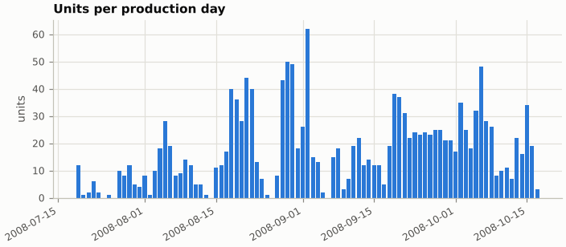
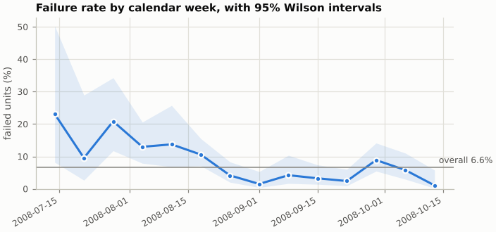
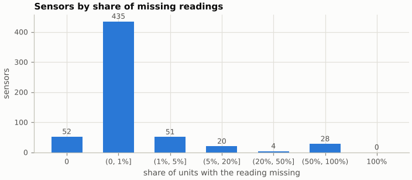

# SECOM exploratory data analysis

Generated by `yg_secom.pipeline` at commit `21d77afb0655` from `secom.data` SHA-256 `20f0e7ee434f...`, `secom.names` SHA-256 `6d91b0b46cde...`, `secom_labels.data` SHA-256 `126884cf4537...`.

Every number on this page is computed from the source files by
`yg_secom.eda`; nothing is copied from documentation.

## Counts and class balance

| Quantity | Value |
|---|---|
| Units (rows) | 1,567 |
| Sensor features (columns) | 590 |
| Failed final test | 104 |
| Passed final test | 1,463 |
| Failure prevalence | 6.64% (95% Wilson CI 5.51% to 7.98%) |
| Missing cells | 41,951 of 924,530 (4.54%) |

## Time structure

| Quantity | Value |
|---|---|
| First unit | 2008-07-19T11:55:00Z |
| Last unit | 2008-10-17T06:07:00Z |
| Span | 89.8 days (91 calendar days) |
| Days with at least one unit | 86 |
| Calendar days without units | 5 |
| Units per production day (min / median / max) | 1 / 16 / 62 |
| Timestamp format | `%d/%m/%Y %H:%M:%S` (example `19/07/2008 11:55:00`) |
| Timestamps whose day field exceeds 12 (proves day-first) | 963 |
| Timestamps also valid as month-first | 604 |
| File order is chronological | yes (0 backward steps) |
| Units sharing a timestamp with another unit | 65 in 32 groups (largest 3) |
| Time zone | none in source; stored as UTC without conversion |

### Failure rate over time

| Week starting | Units | Failures | Failure rate | 95% Wilson CI |
|---|---|---|---|---|
| 2008-07-14 | 13 | 3 | 23.1% | 8.2% to 50.3% |
| 2008-07-21 | 21 | 2 | 9.5% | 2.7% to 28.9% |
| 2008-07-28 | 48 | 10 | 20.8% | 11.7% to 34.3% |
| 2008-08-04 | 108 | 14 | 13.0% | 7.9% to 20.6% |
| 2008-08-11 | 51 | 7 | 13.7% | 6.8% to 25.7% |
| 2008-08-18 | 208 | 22 | 10.6% | 7.1% to 15.5% |
| 2008-08-25 | 169 | 7 | 4.1% | 2.0% to 8.3% |
| 2008-09-01 | 133 | 2 | 1.5% | 0.4% to 5.3% |
| 2008-09-08 | 95 | 4 | 4.2% | 1.6% to 10.3% |
| 2008-09-15 | 154 | 5 | 3.2% | 1.4% to 7.4% |
| 2008-09-22 | 166 | 4 | 2.4% | 0.9% to 6.0% |
| 2008-09-29 | 169 | 15 | 8.9% | 5.5% to 14.1% |
| 2008-10-06 | 138 | 8 | 5.8% | 3.0% to 11.0% |
| 2008-10-13 | 94 | 1 | 1.1% | 0.2% to 5.8% |

A chi-square test of homogeneity across the 14 weeks gives statistic 60.02 on 13 degrees of freedom, p = 5.21e-08 (smallest expected weekly failure count 0.9; approximate when expected failure counts per week fall below 5).

## Missingness

538 of 590 sensors have at least one missing reading; 28 miss more than half.
Per unit, the share of missing readings ranges from 0.7% to 25.8% (median 4.1%).
Units with no readings at all: 0.

| Share of units missing | Sensors |
|---|---|
| 0 | 52 |
| (0, 1%] | 435 |
| (1%, 5%] | 51 |
| (5%, 20%] | 20 |
| (20%, 50%] | 4 |
| (50%, 100%) | 28 |
| 100% | 0 |

Most-missing sensors:

| Sensor | Missing |
|---|---|
| S158 | 91.2% |
| S159 | 91.2% |
| S293 | 91.2% |
| S294 | 91.2% |
| S086 | 85.6% |
| S221 | 85.6% |
| S359 | 85.6% |
| S493 | 85.6% |
| S110 | 65.0% |
| S111 | 65.0% |
| S112 | 65.0% |
| S245 | 65.0% |
| S246 | 65.0% |
| S247 | 65.0% |
| S383 | 65.0% |

## Constant, near-constant and duplicated features

- Constant (no non-missing reading, or every non-missing reading identical): 116 sensors (0 never measured, 116 single-valued).
- Near-constant (not constant, and the most frequent non-missing value covers at least 95% of non-missing readings): 10 sensors.
- Groups of identical sensor columns (identical columns compare values and missing positions; constant columns excluded): 0.
- Units whose 590 readings duplicate another unit's: 0.

The full lists are in `eda.json` (`constant_features`, `near_constant_features`,
`duplicates`). No row is dropped because of any finding on this page.
