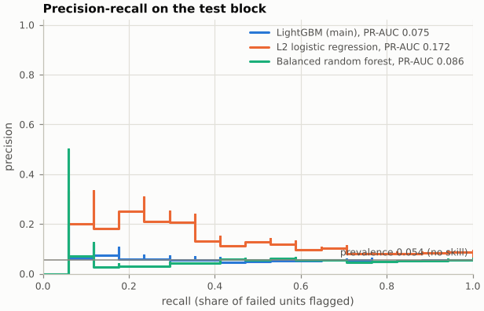
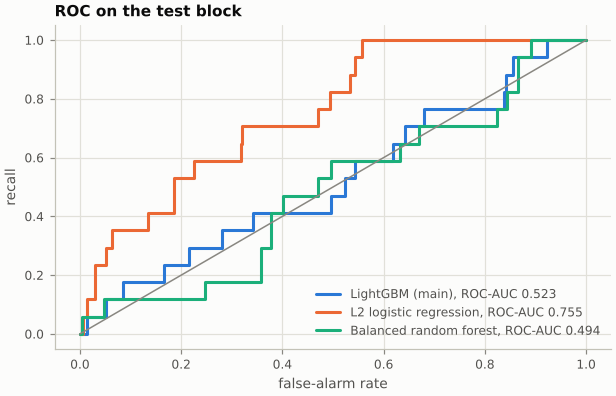
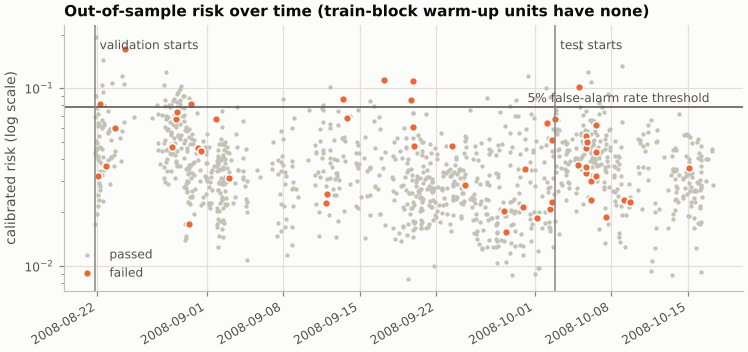
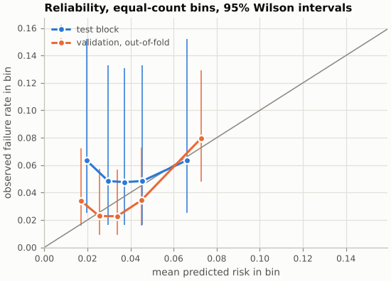
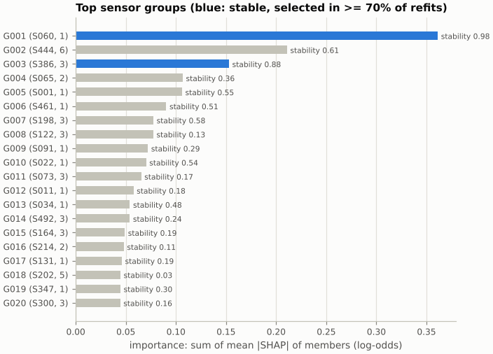
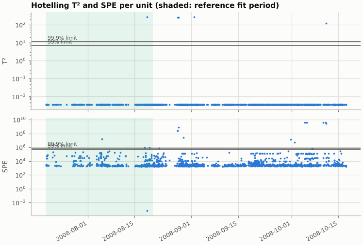
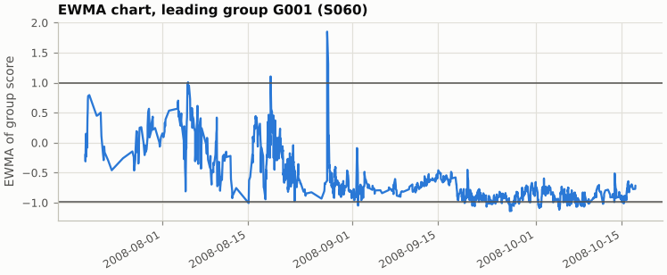
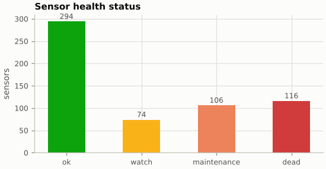

# SECOM results

Generated by `yg_secom.pipeline` at commit `3be24bf54b7d` from `secom.data` SHA-256 `20f0e7ee434f...`, `secom.names` SHA-256 `6d91b0b46cde...`, `secom_labels.data` SHA-256 `126884cf4537...`.

Every performance number below comes from units the scoring model never saw while it was fitted. The test block was evaluated once, after every choice was fixed; validation-block numbers are out-of-fold but were used to choose settings, so they are optimistic. Intervals are 95% intervals; the method is named in each table. Findings about sensors are statistical associations with failure, not causes.

## Headline (test block)

| Quantity | Value (95% CI) |
|---|---|
| PR-AUC, LightGBM | 0.075 (0.048 to 0.181) |
| PR-AUC, no skill (test failure rate) | 0.054 (0.054 to 0.054) |
| ROC-AUC, LightGBM | 0.523 (0.384 to 0.665) |
| Recall at the 5% false-alarm rate threshold (set on validation) | 5.9% (0.0 to 17.6%) |
| Achieved test false-alarm rate at that threshold | 2.0% (0.7 to 3.7%) |
| False alarms per 100 units at that threshold | 1.92 (0.64 to 3.51) |
| Stable sensor groups (sensors in them) | 2 (4 of 468 model sensors) |

## 1. Data and chronological split

1567 units, 590 sensors, 104 failures; see [eda.md](eda.md). Split rule: units sorted by timestamp (unit id breaks ties), cuts only between different timestamps; test = last 20% of units; development period = everything before it; train = first 30% of the development period (rolling-origin warm-up, fitting only); validation = the rest of the development period (rolling-origin evaluation slices); a block start moves one timestamp at a time until every block holds at least 15 failures.

| Block | Role | Units | Failures | Failure rate | First unit | Last unit |
|---|---|---|---|---|---|---|
| train | rolling-origin warm-up: fitting only, no out-of-sample risk | 376 | 53 | 14.1% | 2008-07-19T11:55:00Z | 2008-08-21T18:53:00Z |
| validation | rolling-origin evaluation slices: out-of-fold risk; tuning, calibration, thresholds | 878 | 34 | 3.9% | 2008-08-21T19:12:00Z | 2008-10-02T20:54:00Z |
| test | untouched until the single final evaluation | 313 | 17 | 5.4% | 2008-10-02T21:32:00Z | 2008-10-17T06:07:00Z |

Development period (train and validation blocks, every unit before the test block): 1254 units, 87 failures, 2008-07-19T11:55:00Z to 2008-10-02T20:54:00Z. Final models are refitted on all of it.

Why not a plain 60/20/20 split: it would give train 940 units (76 failures), validation 314 (11) and test 313 (17); a single validation block this small holds too few failures to tune hyperparameters or fit a calibrator on; rolling-origin validation over the whole development period uses every failure after the warm-up instead.

No boundary adjustment was needed: every block held at least 15 failures.

Leakage check: passed: train < validation < test strictly in time, every unit in exactly one block, tied timestamps never split.

Rolling-origin cross-validation: expanding window over the development period; the train block (warm-up) is only fitted on; the validation block is cut into 5 consecutive slices of about equal size, each predicted by a model fitted on every earlier unit; slices with fewer than 5 failures are merged with a neighbour. Warm-up (train block): 376 units (53 failures); no slice merged.

| Fold | Fitting units (failures) | Evaluation units (failures) | Evaluation period | LightGBM AP | Logistic AP | Random forest AP |
|---|---|---|---|---|---|---|
| 0 | 376 (53) | 176 (8) | 2008-08-21T19:12 to 2008-08-30T00:01 | 0.119 | 0.066 | 0.158 |
| 1 | 552 (61) | 175 (6) | 2008-08-30T00:05 to 2008-09-04T11:50 | 0.186 | 0.260 | 0.049 |
| 2 | 727 (67) | 176 (5) | 2008-09-04T14:09 to 2008-09-19T07:14 | 0.384 | 0.239 | 0.228 |
| 3 | 903 (72) | 175 (6) | 2008-09-19T07:18 to 2008-09-25T11:08 | 0.494 | 0.041 | 0.124 |
| 4 | 1078 (78) | 176 (9) | 2008-09-25T11:09 to 2008-10-02T20:54 | 0.061 | 0.044 | 0.081 |

## 2. Preprocessing (fitted on training rows only)

On the development period: 468 sensors kept, 122 dropped (constant or never measured there), 4 missingness indicators added out of 442 sensors tested (Fisher's exact test, Benjamini-Hochberg q <= 0.05; smallest q 0.022), 472 model columns in total. Each fold repeats this on its own fitting rows: fold 0: 456 columns, 4 indicators, fold 1: 452 columns, 0 indicators, fold 2: 452 columns, 0 indicators, fold 3: 468 columns, 0 indicators, fold 4: 472 columns, 4 indicators.

## 3. Models and tuning

LightGBM: optuna TPESampler(seed=136952034), 80 trials, sequential; objective mean average precision over the rolling-origin folds. Best mean fold average precision 0.249 (optimistic, because these folds chose the parameters).

| Hyperparameter | Search space | Chosen |
|---|---|---|
| learning_rate | log-uniform [0.01, 0.2] | 0.1289 |
| num_boost_round | log-uniform integer [50, 800] | 52 |
| num_leaves | integer [2, 16] | 15 |
| max_depth | integer [1, 5] | 1 |
| min_data_in_leaf | integer [10, 80] | 75 |
| feature_fraction | uniform [0.05, 0.5] | 0.3351 |
| bagging_fraction | uniform [0.5, 1.0] (bagging every iteration) | 0.8917 |
| lambda_l1 | log-uniform [0.001, 10] | 0.002414 |
| lambda_l2 | log-uniform [0.01, 100] | 0.4306 |
| min_gain_to_split | uniform [0, 1] | 0.654 |
| extra_trees | {false, true} | True |

Fixed: class weight `scale_pos_weight` = passed/failed units in the fitting rows, `deterministic=True`, `force_row_wise=True`, one thread, `max_bin` 63, seed 1209624234.

Logistic regression: median imputation, standardisation, L2 logistic regression with balanced class weights (lbfgs); C chosen from grid over C = [1e-05, 3e-05, 0.0001, 0.0003, 0.001, 0.003, 0.01, 0.03, 0.1, 0.3, 1.0, 3.0] by the same folds: C = 0.01 (mean fold average precision 0.130).

Balanced random forest: median imputation, imbalanced-learn BalancedRandomForestClassifier, settings {'sampling_strategy': 'all', 'replacement': True, 'bootstrap': False, 'max_features': 'sqrt', 'min_samples_leaf': 1, 'n_estimators': 500, 'random_state': 1265424603}, not tuned.

## 4. Test block (evaluated once)

| Model | PR-AUC (95% CI) | ROC-AUC (95% CI) | Brier (95% CI) | ECE (95% CI) |
|---|---|---|---|---|
| LightGBM (main) | 0.075 (0.048 to 0.181) | 0.523 (0.384 to 0.665) | 0.0516 (0.0506 to 0.0526) | 0.0158 (0.0149 to 0.0431) |
| L2 logistic regression | 0.172 (0.098 to 0.380) | 0.755 (0.652 to 0.851) | 0.0516 (0.0515 to 0.0516) | 0.0458 (0.0329 to 0.0552) |
| Balanced random forest | 0.086 (0.046 to 0.237) | 0.494 (0.364 to 0.628) | 0.0517 (0.0511 to 0.0521) | 0.0302 (0.0185 to 0.0474) |
| Prevalence (no skill) | 0.054 (0.054 to 0.054) | 0.500 (0.500 to 0.500) | 0.0516 (0.0516 to 0.0516) | 0.0156 (0.0156 to 0.0156) |

PR-AUC is average precision (step-function area, no interpolation); its no-skill value is the block's failure rate. Brier and ECE use Platt-calibrated probabilities (each model calibrated on its own pooled out-of-fold validation scores). Constant 0.0387, the validation-block failure rate (the data every calibrator was fitted on).

Paired comparison of PR-AUC (LightGBM minus baseline), paired stratified bootstrap on the same resamples; two-sided p-value by percentile-interval inversion:

| Baseline | Difference (95% CI) | p-value |
|---|---|---|
| L2 logistic regression | -0.097 (-0.307 to 0.036) | 0.13 |
| Balanced random forest | -0.011 (-0.138 to 0.099) | 0.85 |
| Prevalence (no skill) | 0.021 (-0.007 to 0.127) | 0.17 |







## 5. Operating points

Thresholds are set on the validation block (pooled out-of-fold calibrated risk: the smallest threshold whose false-alarm rate there is at most the target) and applied unchanged to the test block. Intervals are stratified bootstrap intervals conditional on the threshold.

| Operating point | Threshold (risk) | Test false-alarm rate | Recall | Precision | False alarms per 100 units | TP | FP | TN | FN |
|---|---|---|---|---|---|---|---|---|---|
| 5% false-alarm rate (set on validation) | 0.0787 | 2.0% (0.7 to 3.7%) | 5.9% (0.0 to 17.6%) | 14.3% (0.0 to 50.0%) | 1.92 (0.64 to 3.51) | 1 | 6 | 290 | 16 |
| 10% false-alarm rate (set on validation) | 0.0670 | 5.1% (2.7 to 7.4%) | 11.8% (0.0 to 29.4%) | 11.8% (0.0 to 27.8%) | 4.79 (2.56 to 7.03) | 2 | 15 | 281 | 15 |

On the validation block (where the thresholds were set):

| Operating point | Threshold | False-alarm rate | Recall | Precision | TP | FP | TN | FN |
|---|---|---|---|---|---|---|---|---|
| fpr_0.05 | 0.0787 | 5.0% | 20.6% | 14.3% | 7 | 42 | 802 | 27 |
| fpr_0.10 | 0.0670 | 10.0% | 29.4% | 10.6% | 10 | 84 | 760 | 24 |

## 6. Calibration

Platt scaling on the pooled out-of-fold validation scores: a = -0.8343, b = 2.5523 (p = 1 / (1 + exp(a z + b)), z = raw log-odds; 34 failures among 878 units; Newton fit converged). The map is increasing, so ranking metrics are unchanged by calibration. The calibrator was fitted on fold-model scores and is applied to the final model refitted on the whole development period (Platt, 1999); the test block checks whether that transfer holds. Isotonic regression was rejected: isotonic regression has up to one free level per distinct score and overfits a calibration set with few failures; its flat steps also tie units the model ranks differently.

| Block | Brier | ECE |
|---|---|---|
| Validation, out-of-fold (calibrator fitted here, in-sample) | 0.0366 | 0.0097 |
| Test | 0.0516 (0.0506 to 0.0526) | 0.0158 (0.0149 to 0.0431) |

Calibration in the large per rolling-origin slice (mean calibrated risk against the observed failure rate; differences show drift between periods):

| Fold | Units | Failures | Mean predicted | Observed (95% Wilson CI) |
|---|---|---|---|---|
| 0 | 176 | 8 | 0.0590 | 0.0455 (0.0232 to 0.0871) |
| 1 | 175 | 6 | 0.0349 | 0.0343 (0.0158 to 0.0728) |
| 2 | 176 | 5 | 0.0378 | 0.0284 (0.0122 to 0.0648) |
| 3 | 175 | 6 | 0.0309 | 0.0343 (0.0158 to 0.0728) |
| 4 | 176 | 9 | 0.0312 | 0.0511 (0.0271 to 0.0943) |

Reliability on the test block, 5 equal-count bins (equal-count bins; with few failures per bin the observed rates are very uncertain (Wilson intervals shown)):

| Bin | Units | Failures | Mean predicted | Observed (95% Wilson CI) |
|---|---|---|---|---|
| 1 | 63 | 4 | 0.0196 | 0.0635 (0.0250 to 0.1522) |
| 2 | 62 | 3 | 0.0297 | 0.0484 (0.0166 to 0.1329) |
| 3 | 63 | 3 | 0.0372 | 0.0476 (0.0163 to 0.1309) |
| 4 | 62 | 3 | 0.0455 | 0.0484 (0.0166 to 0.1329) |
| 5 | 63 | 4 | 0.0661 | 0.0635 (0.0250 to 0.1522) |



## 7. Validation block, out-of-fold (optimistic)

Each validation unit was scored by a fold model fitted only on earlier units, but these scores chose the hyperparameters, the calibrators and the thresholds. Pooling across fold models also mixes models fitted on different amounts of data. Shown for transparency, not as a performance claim.

| Model | PR-AUC (95% CI) | ROC-AUC (95% CI) | Brier (95% CI) | ECE (95% CI) |
|---|---|---|---|---|
| LightGBM (main) | 0.107 (0.060 to 0.225) | 0.636 (0.530 to 0.738) | 0.0366 (0.0358 to 0.0373) | 0.0097 (0.0054 to 0.0230) |
| L2 logistic regression | 0.070 (0.033 to 0.165) | 0.480 (0.382 to 0.584) | 0.0372 (0.0372 to 0.0372) | 0.0063 (0.0042 to 0.0209) |
| Balanced random forest | 0.080 (0.043 to 0.178) | 0.596 (0.509 to 0.679) | 0.0370 (0.0366 to 0.0374) | 0.0152 (0.0083 to 0.0292) |
| Prevalence (no skill) | 0.039 (0.039 to 0.039) | 0.500 (0.500 to 0.500) | 0.0372 (0.0372 to 0.0372) | 0.0000 (0.0000 to 0.0000) |

## 8. Root-cause narrowing (development period)

Sensor groups: spearman, pairwise-complete observations, |rho| >= 0.8, average linkage: 242 groups from 468 model sensors (120 singletons, largest 8); 64 sensor pairs had too few joint readings and count as uncorrelated. The model uses 32 groups. Importance: sum over members of mean |TreeSHAP| (log-odds) over development-period units, final model (fitted on the development period).

Stability: 100 refits (stratified bootstrap of the development period; preprocessing fixed; one seed per refit); a group is stable when it is in the top 20 in at least 70% of refits. Stable groups: 2.

Chance check: 200 label permutations, p = (1 + #{null >= observed}) / (1 + permutations), Benjamini-Hochberg across all groups. Significant groups at q <= 0.05: 0 (smallest q 0.4). with 200 permutations the smallest p-value is 0.0050; Benjamini-Hochberg across 242 groups can declare k groups significant only if k >= 25 of them reach that floor; 2 groups reached it.

Univariate screen: Mann-Whitney U, two-sided, failed versus passed development-period units, missing readings excluded; Benjamini-Hochberg across tested sensors; 468 sensors tested, 19 with q <= 0.05: S001, S022, S029, S034, S060, S080, S104, S130, S153, S156, S206, S248, S291, S342, S386, S429, S478, S511, S520.

Top 20 groups by importance:

| Group | Sensors | Representative | Importance | Stability | Permutation p | q | Significant | Strongest univariate member (q, direction) |
|---|---|---|---|---|---|---|---|---|
| G001 | S060 (1) | S060 | 0.3613 | 0.98 | 0.005 | 0.4 | no | S060 (q 6.4e-10, higher in failures) |
| G002 | S173, S175, S308, S310, S444, S446 (6) | S444 | 0.2108 | 0.61 | 0.015 | 0.52 | no | S173 (q 0.26, higher in failures) |
| G003 | S248, S386, S520 (3) | S386 | 0.1529 | 0.88 | 0.005 | 0.4 | no | S248 (q 2.2e-04, higher in failures) |
| G004 | S065, S066 (2) | S065 | 0.1068 | 0.36 | 0.01 | 0.4 | no | S066 (q 0.55, higher in failures) |
| G005 | S001 (1) | S001 | 0.1061 | 0.55 | 0.01 | 0.4 | no | S001 (q 0.015, lower in failures) |
| G006 | S461 (1) | S461 | 0.0904 | 0.51 | 0.01 | 0.4 | no | S461 (q 0.052, higher in failures) |
| G007 | S198, S334, S470 (3) | S198 | 0.0775 | 0.58 | 0.05 | 0.75 | no | S334 (q 0.064, higher in failures) |
| G008 | S122, S124, S125 (3) | S122 | 0.0774 | 0.13 | 0.02 | 0.54 | no | S125 (q 0.26, higher in failures) |
| G009 | S091 (1) | S091 | 0.0720 | 0.29 | 0.01 | 0.4 | no | S091 (q 0.22, lower in failures) |
| G010 | S022 (1) | S022 | 0.0702 | 0.54 | 0.02 | 0.54 | no | S022 (q 0.016, higher in failures) |
| G011 | S067, S071, S073 (3) | S073 | 0.0653 | 0.17 | 0.07 | 0.89 | no | S073 (q 0.94, higher in failures) |
| G012 | S011 (1) | S011 | 0.0576 | 0.18 | 0.035 | 0.72 | no | S011 (q 0.21, higher in failures) |
| G013 | S034 (1) | S034 | 0.0540 | 0.48 | 0.03 | 0.72 | no | S034 (q 0.015, higher in failures) |
| G014 | S220, S358, S492 (3) | S492 | 0.0539 | 0.24 | 0.055 | 0.78 | no | S358 (q 0.24, higher in failures) |
| G015 | S164, S299, S435 (3) | S164 | 0.0489 | 0.19 | 0.095 | 0.95 | no | S299 (q 0.21, higher in failures) |
| G016 | S214, S352 (2) | S214 | 0.0479 | 0.11 | 0.04 | 0.72 | no | S352 (q 0.14, higher in failures) |
| G017 | S131 (1) | S131 | 0.0460 | 0.19 | 0.045 | 0.72 | no | S131 (q 0.41, higher in failures) |
| G018 | S197, S202, S333, S338, S474 (5) | S202 | 0.0446 | 0.03 | 0.15 | 1 | no | S202 (q 0.88, higher in failures) |
| G019 | S347 (1) | S347 | 0.0446 | 0.30 | 0.04 | 0.72 | no | S347 (q 0.11, higher in failures) |
| G020 | S165, S300, S436 (3) | S300 | 0.0444 | 0.16 | 0.09 | 0.95 | no | S300 (q 0.39, higher in failures) |



## 9. Fault detection and classification

Reference: candidate references are the passing units within the first 50%, 40%, 30%, 20% of the development period (in time order); the longest stationary one is used. Stationarity test: KPSS level-stationarity test (statsmodels, regression='c', automatic lags) on the first 5 principal-component scores, each at level 0.01 (Bonferroni, family level 0.05); statsmodels reports p-values only within [0.01, 0.10].

| Candidate (share of development period) | Passing units | Components rejecting | Stationary |
|---|---|---|---|
| 50% | 562 | none | yes |

Chosen reference: 562 passing units; the earlier 281 fit the model and the later 281 are held out.

Model: 437 features (153 left out: more than half missing, constant, or zero MAD in the reference); reference median imputation (FDC only); normal-consistent MAD scale; centred at the reference mean after imputation. PCA keeps 1 components (100.0% of variance; target 90%); parallel analysis suggests 1 (Horn, 200 column permutations, 95th percentile).

Limits: T² 6.75 (99%) and 11.10 (99.9%), Phase II F limit for a new observation; SPE 439225.60 and 796122.76, Jackson-Mudholkar.

False-alarm rate on the held-out half of the reference (nominal 1% and 0.1% per statistic, at most 2% and 0.2% for either):

| Limit | Statistic | Alarms / units | Rate (exact 95% CI) | Rate (day-clustered bootstrap 95% CI) |
|---|---|---|---|---|
| 99% | T2 | 2 / 281 | 0.7% (0.1 to 2.5%) | 0.7% (0.0 to 1.8%) |
| 99% | SPE | 4 / 281 | 1.4% (0.4 to 3.6%) | 1.4% (0.4 to 2.6%) |
| 99% | T2 or SPE | 4 / 281 | 1.4% (0.4 to 3.6%) | 1.4% (0.4 to 2.6%) |
| 99.9% | T2 | 2 / 281 | 0.7% (0.1 to 2.5%) | 0.7% (0.0 to 1.8%) |
| 99.9% | SPE | 3 / 281 | 1.1% (0.2 to 3.1%) | 1.1% (0.0 to 2.2%) |
| 99.9% | T2 or SPE | 3 / 281 | 1.1% (0.2 to 3.1%) | 1.1% (0.0 to 2.2%) |



Association of FDC flags with failure (all units outside the FDC reference stretch (later development units and the test block); association only, not causation; 1005 units):

| Flag | Flagged (failed / passed) | Failure rate when flagged | Failure rate otherwise | Odds ratio (95% CI) | Fisher p |
|---|---|---|---|---|---|
| beyond the 99% limit (T2 or SPE) | 2 / 8 | 20.0% (5.7 to 51.0%) | 10.3% (8.5 to 12.3%) | 2.19 (0.22 to 11.16) | 0.28 |
| beyond the 99.9% limit (T2 or SPE) | 2 / 7 | 22.2% (6.3 to 54.7%) | 10.2% (8.5 to 12.3%) | 2.50 (0.25 to 13.37) | 0.24 |

Small, slow shifts: EWMA with lambda = 0.2 and L = 2.962 (asymptotic, +/- L sqrt(lambda / (2 - lambda)); in-control ARL under normality 500 units); tabular CUSUM with k = 0.5 and h = 5.0 (both sums restart at zero after a signal; in-control ARL 465 units). Input: sign-aligned mean of the members' FDC-standardised values, standardised by the fit-reference mean and SD.

| Leading group | Representative | Members used | EWMA alarms (held-out reference) | CUSUM alarms (held-out reference) |
|---|---|---|---|---|
| G001 | S060 | 1 | 123 (2) | 75 (9) |
| G003 | S386 | 3 | 10 (4) | 16 (7) |
| G002 | S444 | 6 | 16 (0) | 5 (0) |
| G004 | S065 | 2 | 8 (0) | 7 (0) |
| G005 | S001 | 1 | 61 (3) | 23 (1) |

Held-out reference units: 281.



Limitation: SECOM has no drift labels: these alarms cannot be scored as correct or incorrect, only checked for their false-alarm rate on held-out in-control data and for association with failure.

## 10. Sensor health

| Status | Sensors |
|---|---|
| ok | 294 |
| watch | 74 |
| maintenance | 106 |
| dead | 116 |

Rules (first matching level wins; each sensor's `reasons` in health.json name the rules that fired, with their values):

- dead: never measured, or a single distinct value over the whole period
- maintenance: a flatline window (at least 5 readings in a calendar week, all identical, with reference probability p_v ** n < 0.001); or a stuck value (a run of R >= 5 identical consecutive readings with n_readings * p_v ** (R - 1) < 0.01); or a week missing at least 50% of readings while the reference misses at most 10%; or at least 20% of readings after the reference outside the reference range
- watch: jumps (|robust z of a first difference| > 104.54, a threshold exceeded by 0.1% of reference differences) more frequent after the reference than the in-control share 0.100% allows (one-sided exact binomial test, Benjamini-Hochberg q <= 0.05); or a week missing at least 20% of readings while the reference misses at most 10%; or at least 5% of readings after the reference outside the reference range
- ok: none of the above

Windows: ISO calendar weeks, Monday 00:00 to next Monday 00:00 (exclusive). Reference: FDC reference fit set (earlier half of the stationary early stretch of passing development units); the later half is held out (281 units; 281 held out).

Jump threshold, calibrated on the reference: z* = 104.54, the smallest |z| exceeded by at most 0.1% of 120,614 reference first differences (444 sensors with a computable z; share flagged there 0.099%). On the held-out reference: 0.1% (0.1 to 0.1%) of 119,704 differences flagged (out-of-sample check). 47 of 474 live sensors have at least one jump somewhere in the period; the status uses jump frequency, not a single jump. 30 live sensors have no computable z (zero MAD of reference differences, mostly discrete readings).

Out-of-reference check: for exchangeable continuous data the expected rate is 0.71%; on the held-out reference the median rate over 458 sensors is 0.71%, and 36 sensors reach the watch rate there.

Missingness versus failure (Fisher exact test on the development period (test labels never used), Benjamini-Hochberg across testable sensors): 4 of 442 testable sensors at q <= 0.05 (smallest q 0.022): S073, S074, S346, S347.



## 11. Limitations

- Few failures: the test block holds 17 and the validation block 34, so every interval is wide and small differences between models are not distinguishable.
- The failure rate drifts over time (see eda.md: many failures early, fewer later); a model and calibrator fitted on earlier periods may not transfer to later ones.
- One fab, one product, about three months in 2008, anonymous sensors: results may not transfer to other tools, products or periods, and sensor meanings are unknown.
- The source timestamps have no time zone; they are stored as UTC without conversion.
- Associations, not causes: a sensor group linked to failure may be a proxy for another, unmeasured, factor.
- Validation-block risks come from rolling-origin fold models fitted on less data than the final model; they chose the settings and the calibrator, so their metrics are optimistic. The calibrator is fitted on fold-model scores and applied to the final model, an approximation the test block checks.
- Operating-point intervals are conditional on the thresholds chosen on the validation block; the variability of the threshold choice itself is not included.
- The test-block curve in operating_points.json is descriptive; choosing a new threshold from it and reporting test performance at that threshold would be optimistic.
- Reliability bins hold few failures each, so the observed rates are very uncertain.
- with 200 permutations the smallest p-value is 0.0050; Benjamini-Hochberg across 242 groups can declare k groups significant only if k >= 25 of them reach that floor.
- Stability selection uses bootstrap resamples (not the half-samples of Meinshausen and Buehlmann), so their error bound does not apply; stability is descriptive.
- FDC has no drift labels in SECOM; alarms are judged only by their false-alarm rate on held-out in-control data and by association with failure. The PCA reference holds fewer units than sensors, so the covariance is estimated with few degrees of freedom.
- Sensor-health rules are deterministic and label-free; the jump test treats consecutive differences as independent, which a single spike violates.
- Missingness of sensor readings: 4 sensors associated with failure after Benjamini-Hochberg on the development period; reported as found, without searching for a test variant that would find more.

## 12. Reproducibility

```
cd training/secom
uv sync
uv run python -m yg_secom.pipeline --data ../../data/secom --out ../../artifacts/secom/v1
```

Master seed 20261014; every random stream is derived from it by name (SHA-256). LightGBM runs single-threaded and deterministic, so a rerun with the locked environment reproduces every file except the creation time in MANIFEST.json.

| Package | Version |
|---|---|
| yg-secom | 0.1.0 |
| yg-common | 0.1.0 |
| numpy | 2.5.4 |
| pandas | 3.0.6 |
| pyarrow | 26.0.0 |
| scipy | 1.18.1 |
| scikit-learn | 1.9.1 |
| imbalanced-learn | 0.14.2 |
| lightgbm | 4.7.0 |
| optuna | 5.0.0 |
| statsmodels | 0.15.0 |
| pandera | 0.34.1 |
| pydantic | 2.14.1 |
| matplotlib | 3.11.2 |
| joblib | 1.6.0 |
| mlflow-skinny | 3.17.1 |
| jsonschema | 4.26.0 |
| Python | 3.13.16 |

| Data file | SHA-256 |
|---|---|
| secom.data | `20f0e7ee434f7dcbae0eea9ffff009a2b57f42d6b0dc9a5bd4f00782c0a3374c` |
| secom.names | `6d91b0b46cdee03064ee3e3112f937c1b3f7fcd9933575794ec07974e6f1ea59` |
| secom_labels.data | `126884cf453705c9e61a903fe906f0665a3b45ce3639e621edc5c93c89627e03` |
